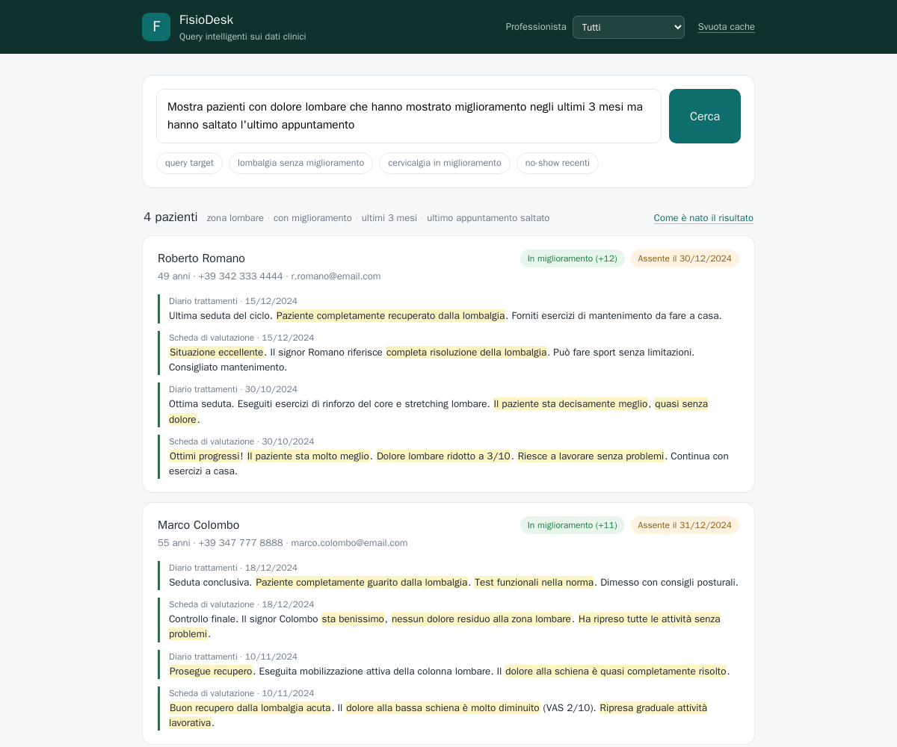
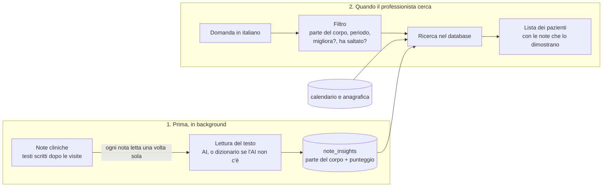

# FisioDesk – Query intelligenti sui dati clinici

Prototipo per il compito "AI Assistant: integrazione query intelligenti per professionisti sanitari" di Dreambuilders. Un fisioterapista scrive una domanda in italiano e il sistema risponde con la lista dei pazienti giusti, mostrando i testi che giustificano ogni risultato.

Stack: Java 17, Spring Boot 3.5, Spring AI 1.1, MongoDB. Ho scelto Java e Spring Boot perché è lo stack di FisioDesk/Dottai, così il codice si integra nel backend esistente. L'interfaccia demo è una pagina HTML/JS servita dalla stessa applicazione.

## 1. Il problema

La domanda da cui parte tutto (la "query target" della consegna) è:

> *"Mostra pazienti con dolore lombare che hanno mostrato miglioramento negli ultimi 3 mesi ma hanno saltato l'ultimo appuntamento"*

I dati con cui rispondere sono quelli del gestionale:

- **Note cliniche**: dopo ogni visita il fisioterapista scrive un testo libero sul paziente, per esempio *"Paziente riferisce miglioramento del dolore lombare. Scala del dolore da 8/10 a 3/10"*. Nel database stanno in due tabelle, `schede_valutazione` (le valutazioni) e `diario_trattamenti` (le sedute).
- **Calendario** (`eventi_calendario`): ogni appuntamento ha uno stato: completato, cancellato, prenotato oppure `no_show`, che vuol dire che il paziente non si è presentato.
- **Anagrafica** (`pazienti`): nome, età, contatti.

Per rispondere bisogna fare quattro cose insieme: capire dai testi chi ha mal di schiena, capire dai testi chi sta migliorando, guardare nel calendario chi ha saltato l'ultimo appuntamento, e considerare solo gli ultimi 3 mesi. Le prime due richiedono di capire un testo scritto a mano libera, con sinonimi ("lombalgia", "mal di schiena", "low back pain") e negazioni ("non risponde alla terapia"): qui serve l'AI. Il vincolo è rispondere in meno di 2 secondi anche con 50 professionisti che cercano insieme, senza spendere troppo in chiamate AI.

## 2. Come far partire il sistema

Serve solo Docker (con Compose v2).

```bash
git clone https://github.com/simplayy/fisiodesk-ai-healthcare-assignment.git
cd fisiodesk-ai-healthcare-assignment
docker compose up -d --build
```

Dopo circa un minuto (la prima volta di più, per scaricare le dipendenze):

- http://localhost:8080 interfaccia web e API
- http://localhost:8081 Mongo Express, per sfogliare i dati

All'avvio il database viene riempito con i dati di esempio e le note vengono lette e indicizzate.

Questo comando funziona **senza nessuna chiave API**, così puoi provare il sistema subito: al posto dell'AI i testi vengono letti da un dizionario di termini fisioterapici. Con una chiave (o con un modello in locale) le note le legge un'AI vera: è la sezione 5, ed è il funzionamento normale del sistema.

## 3. Provalo: la query target

Nell'interfaccia la query target è già scritta, basta premere **Cerca**:



Risultato atteso: **Roberto Romano, Marco Colombo, Mario Rossi, Laura Bianchi**, in ordine di miglioramento. Per ognuno si vedono l'ultimo appuntamento saltato e i testi delle visite che hanno pesato, con le frasi decisive evidenziate. Il link "Come è nato il risultato" apre una spiegazione: quali parole della domanda sono state riconosciute, quanto ha impiegato ogni passaggio, e chi è stato escluso e perché:

- Anna Ferrari: ha mal di schiena e ha saltato l'appuntamento, ma le sue note dicono "situazione stazionaria" e "lieve peggioramento".
- Giuseppe Verdi: sta migliorando, ma della cervicale, e al suo ultimo appuntamento si è presentato.
- Francesca Ricci: ha solo dati di giugno, fuori dagli ultimi 3 mesi.

La stessa domanda da terminale:

```bash
curl -s -X POST http://localhost:8080/api/query \
  -H 'Content-Type: application/json' \
  -d '{"question":"Mostra pazienti con dolore lombare che hanno mostrato miglioramento negli ultimi 3 mesi ma hanno saltato l'\''ultimo appuntamento"}'
```

Non è un sistema a domanda fissa. Altre domande che funzionano:

```
Pazienti con lombalgia che non mostrano miglioramento negli ultimi 3 mesi   -> Anna Ferrari
Pazienti con cervicalgia in miglioramento negli ultimi 2 mesi               -> Giuseppe Verdi
Chi ha saltato l'ultimo appuntamento?                                       -> tutti quelli che non si sono presentati
```

I dati di esempio vanno da marzo a dicembre 2024, quindi come "oggi" viene usata la data dell'ultimo appuntamento in calendario (31/12/2024). Si può cambiare con la variabile `REFERENCE_DATE` o con il campo `referenceDate` della richiesta.

## 4. Come funziona

Capire un testo libero lo sa fare bene un'AI, ma è lenta e costa. Se a ogni ricerca facessimo rileggere tutte le note all'AI, la risposta arriverebbe dopo molti secondi e ogni ricerca costerebbe soldi. Per questo il sistema lavora in due momenti separati:



**Prima, in background.** Ogni 30 secondi il sistema controlla se ci sono note nuove o modificate e le fa leggere all'AI (oppure, se l'AI non è disponibile, al dizionario di termini). Da ogni nota ricava due cose e le salva nella tabella `note_insights`:

- di quale parte del corpo parla: "lombalgia", "mal di schiena", "low back pain" e "colpo della strega" sono tutti la stessa cosa, la zona lombare;
- un punteggio da -3 a +3: positivo se la nota dice che il paziente migliora, negativo se peggiora o resta uguale. Le negazioni vengono capite: "non risponde alla terapia" è negativo.

Ogni nota viene letta una volta sola; dopo, il risultato è già lì.

**Quando il professionista cerca.** La domanda viene trasformata in un filtro con quattro caselle: parte del corpo, periodo, migliora sì/no, ha saltato l'ultimo appuntamento sì/no. Per la query target: zona lombare, ultimi 3 mesi, migliora sì, ha saltato sì. Anche questo lo fa l'AI, ma solo la prima volta che una domanda viene fatta: il filtro viene salvato e le volte dopo l'AI non serve più. Poi il filtro viene applicato con normali ricerche nel database: per ogni paziente si sommano i punteggi delle sue note lombari degli ultimi 3 mesi (somma positiva = sta migliorando) e si guarda il suo ultimo appuntamento (se è `no_show` l'ha saltato). Chi passa tutte le condizioni finisce nella lista, insieme alle note che lo dimostrano.

**Un esempio.** Mario Rossi ha due note, di novembre e dicembre, che parlano di dolore lombare in miglioramento (punteggio totale positivo) e il suo ultimo appuntamento, il 20/12, è `no_show`: è nella lista. Anna Ferrari ha note lombari, ma con punteggio negativo: non c'è, anche se ha saltato l'appuntamento. Giuseppe Verdi ha punteggio positivo ma sulle note della cervicale, non su quelle lombari: non c'è.

**Se l'AI non funziona** (non risponde, dà errore, la quota è finita): al suo posto lavora il dizionario di termini, sia per leggere le note sia per capire le domande. Il sistema risponde comunque, solo in modo un po' meno fine, e nella risposta si vede chi dei due ha lavorato. Quando l'AI torna, le note lette col dizionario vengono rilette dall'AI.

## 5. L'AI: dove lavora e come attivarla

L'AI è il motore del sistema e lavora in due punti, tutti e due fuori dal momento della ricerca:

1. **Legge le note cliniche** quando vengono indicizzate, e ne ricava parte del corpo e punteggio di miglioramento.
2. **Interpreta le domande** in italiano e le trasforma nel filtro, la prima volta che una domanda viene fatta.

Il dizionario di termini non è un'alternativa all'AI: è la **rete di sicurezza**. La consegna chiede "cosa succede se l'AI non funziona", e la risposta è che il dizionario prende il suo posto e il sistema continua a rispondere. Serve anche come controllo: sulle domande, quello che il dizionario riconosce con certezza (per esempio la parola "lombare") viene rimesso nel filtro dell'AI, perché i modelli piccoli ogni tanto perdono per strada un pezzo della domanda.

Il comando della sezione 2 parte con il solo dizionario, così chiunque può provare il sistema senza avere una chiave API (la consegna lo permette esplicitamente: *"AI Provider: puoi usare OpenAI, Anthropic, o mock intelligente"*). Per far lavorare l'AI vera basta uno di questi comandi:

```bash
# AI locale con Ollama: nessuna chiave, scarica circa 1 GB di modello
docker compose -f docker-compose.yml -f docker-compose.ai.yml up -d --build

# Google Gemini: chiave in .env (vedi .env.example)
docker compose -f docker-compose.yml -f docker-compose.gemini.yml up -d --build

# qualunque servizio compatibile con le API OpenAI
AI_ENABLED=true AI_API_KEY=sk-... AI_MODEL=gpt-4o-mini docker compose up -d
```

Da quel momento le note vengono rilette dal modello (`GET /api/stats` mostra quante ne ha già fatte) e le domande nuove le interpreta lui. In ogni risposta, il link "Come è nato il risultato" dice chi ha lavorato su quella richiesta: l'AI, un filtro già salvato, o il dizionario.

Con Gemini il limite dei 2 secondi regge con 100 utenti che cercano insieme (misure in [docs/DESIGN.md](docs/DESIGN.md)).

## 6. Le scelte principali (trade-off)

- **L'AI legge le note prima, non durante la ricerca.** Il costo dipende da quante note vengono scritte, non da quante ricerche vengono fatte, e la ricerca resta sotto i 100 ms. In cambio una nota appena scritta diventa cercabile dopo al massimo 30 secondi, non subito.
- **Limite di tempo sull'AI.** Una domanda nuova aspetta l'AI al massimo 1,5 secondi; se tarda, risponde il dizionario di termini e il filtro dell'AI viene salvato per la volta dopo. Così il tempo di risposta è sempre sotto controllo, ma la prima risposta a una domanda mai vista può essere meno precisa.
- **Dizionario di termini + AI invece di ricerca vettoriale (embedding).** Per questa query servono due informazioni per nota, la parte del corpo e se il paziente migliora: chiederle esplicitamente all'AI dà un risultato che si può spiegare, e il dizionario corregge le negazioni che i modelli piccoli sbagliano. La ricerca vettoriale servirebbe per domande aperte, che qui non ci sono.

## 7. Cosa c'è nel repository

```
├── docker-compose.yml          # MongoDB + dati di esempio + applicazione + Mongo Express
├── docker-compose.ai.yml       # opzionale: AI locale con Ollama
├── docker-compose.gemini.yml   # opzionale: Gemini
├── Dockerfile
├── data/                       # dati di esempio (marzo-dicembre 2024)
├── docs/DESIGN.md              # scelte di progetto, configurazione, limiti, misure
├── scripts/                    # smoke-test.sh (query target), load-test.py (carico)
├── src/main/java/.../analysis  # dizionario di termini, lettura delle note, indexer
├── src/main/java/.../nlq       # domanda -> filtro: AI, parser a regole, controllo
├── src/main/java/.../query     # esecuzione del filtro, cache, spiegazione
├── src/main/java/.../web       # API REST
├── src/main/resources/static   # interfaccia demo
└── src/test/java               # test unitari
```

`ai_integration_homework_v2.md` e `USE_CASES_AND_TESTS.md` sono la consegna e i casi d'uso forniti con i dati.

### API

- `POST /api/query` con `{"question": "...", "referenceDate": "2024-12-31", "professionistaId": "..."}` (gli ultimi due opzionali; con `professionistaId` si vedono solo i pazienti di quel professionista). Risponde con il filtro interpretato, i pazienti con le loro note e la spiegazione.
- `GET /api/stats` note indicizzate e chi le ha lette (AI o dizionario).
- `GET /api/professionisti` professionisti presenti nei dati.
- `DELETE /api/cache` svuota cache e filtri salvati, per far ripassare una domanda dall'AI.

### Test

```bash
./gradlew test                       # test unitari
scripts/smoke-test.sh                # query target sul sistema in esecuzione
scripts/load-test.py load 60 5       # 60 utenti che cercano insieme
```

## 8. Approfondimenti

- [docs/RISPOSTE-CONSEGNA.md](docs/RISPOSTE-CONSEGNA.md): risposta puntuale a tutte le domande della consegna, con il riferimento al punto del codice.
- [docs/DESIGN.md](docs/DESIGN.md): scelte di progetto nel dettaglio, configurazione, limiti noti, misure di carico.
