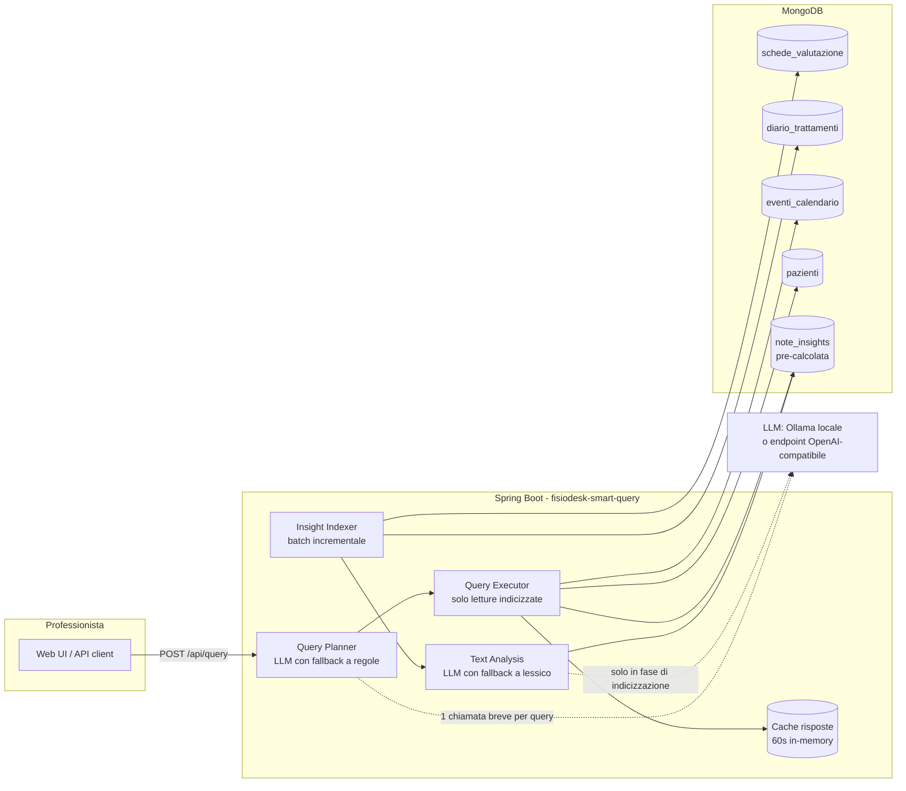

# FisioDesk – Query intelligenti sui dati clinici

Sistema di query in linguaggio naturale sui dati clinici di FisioDesk. Un professionista scrive una domanda come:

> *"Mostra pazienti con dolore lombare che hanno mostrato miglioramento negli ultimi 3 mesi ma hanno saltato l'ultimo appuntamento"*

e ottiene in meno di 100 ms la lista dei pazienti corrispondenti, con le evidenze cliniche (estratti delle schede e del diario trattamenti) che giustificano ogni risultato.

**Stack**: Java 17 · Spring Boot 3.5 · Gradle · MongoDB — allineato allo stack esistente di FisioDesk/Dottai, così i componenti descritti qui si integrano nel backend attuale senza introdurre un nuovo runtime. Frontend demo in HTML/JS statico servito dalla stessa applicazione.

---

## Avvio rapido

Prerequisiti: Docker + Docker Compose.

```bash
git clone <repository-url>
cd fisiodesk-ai-healthcare-assignment
docker compose up -d --build
```

Servizi disponibili:

| Servizio | URL |
|---|---|
| Web UI + API | http://localhost:8080 |
| API query | `POST http://localhost:8080/api/query` |
| Stato indicizzazione | `GET http://localhost:8080/api/stats` |
| MongoDB | `localhost:27017` |
| Mongo Express | http://localhost:8081 |

Al primo avvio l'applicazione indicizza le note cliniche (qualche secondo in modalità deterministica); lo stato è visibile su `/api/stats` e nell'header della UI.

### Demo della query target

Dalla UI (http://localhost:8080) la query target è già precompilata: basta premere **Cerca**. Da terminale:

```bash
curl -s -X POST http://localhost:8080/api/query \
  -H 'Content-Type: application/json' \
  -d '{"question":"Mostra pazienti con dolore lombare che hanno mostrato miglioramento negli ultimi 3 mesi ma hanno saltato l'\''ultimo appuntamento"}'
```

Risultato atteso sul dataset demo: **Roberto Romano, Marco Colombo, Mario Rossi, Laura Bianchi** (in ordine di forza del miglioramento). Anna Ferrari è esclusa (lombalgia ma nessun miglioramento), Giuseppe Verdi è escluso (migliora ma sul rachide cervicale, e non ha saltato l'ultimo appuntamento), Francesca Ricci è esclusa (nessun dato recente).

Altre domande supportate, per mostrare che non è un sistema a query fissa:

```
Pazienti con lombalgia che non mostrano miglioramento negli ultimi 3 mesi   -> Anna Ferrari
Pazienti con cervicalgia in miglioramento negli ultimi 2 mesi               -> Giuseppe Verdi
Chi ha saltato l'ultimo appuntamento?                                       -> tutti i no-show recenti
```

Nota sulle date: il dataset copre marzo–dicembre 2024, quindi come "oggi" viene usata la data dell'ultimo evento in calendario (31/12/2024). È sovrascrivibile con la variabile `REFERENCE_DATE` o col campo `referenceDate` della richiesta.

### Modalità AI con LLM locale (opzionale)

Di default il sistema usa l'analizzatore deterministico (nessuna dipendenza esterna, risultati riproducibili). Per usare un LLM vero ci sono due strade:

**LLM locale via Ollama** (nessuna API key, tutto on-premise):

```bash
docker compose -f docker-compose.yml -f docker-compose.ai.yml up -d --build
```

Il primo avvio scarica il modello (`qwen2.5:1.5b`, ~1 GB). L'indexer ri-analizza le note in background con l'LLM mantenendo il servizio disponibile; anche l'interpretazione della domanda passa all'LLM.

Nota sulla latenza: su CPU il planning LLM di una domanda *nuova* costa qualche secondo; i piani sono cachati 30 minuti, quindi le domande ricorrenti restano sotto i 100 ms. Il vincolo <2s per 50+ utenti concorrenti è garantito dal design (nessuna analisi di testo a runtime, solo letture indicizzate): l'unica parte variabile è la singola chiamata di planning, che in produzione userebbe un modello hosted (~300-500 ms) o il parser a regole.

**Provider esterno** (qualunque endpoint compatibile OpenAI):

```bash
AI_ENABLED=true AI_API_KEY=sk-... AI_MODEL=gpt-4o-mini docker compose up -d
```

In entrambi i casi, se l'LLM non risponde il sistema degrada automaticamente sull'analizzatore deterministico: il servizio non si ferma mai per un problema del provider AI.

---

## Architettura



### L'idea centrale: indicizzare, non ri-analizzare

Il vincolo <2s con 50+ professionisti concorrenti e il budget AI limitato portano alla stessa conclusione: **l'AI non può stare nel percorso di risposta della query sui testi**. La pipeline è quindi divisa in due:

1. **Indicizzazione (batch, incrementale)** — un job periodico confronta `schede_valutazione` e `diario_trattamenti` con la collection `note_insights`: ogni nota nuova o modificata (hash SHA-256 del testo) viene analizzata **una sola volta** e il risultato persistito: aree anatomiche citate (gestendo i sinonimi: "lombalgia", "mal di schiena", "low back pain", "colpo della strega" → `LUMBAR`), segnale di miglioramento (da −3 a +3, con gestione delle negazioni: "non risponde bene alla terapia" non è un miglioramento), evidenze testuali. Il costo AI è proporzionale alle note scritte, non alle query eseguite.

2. **Query (real-time)** — la domanda viene tradotta in un piano strutturato (aree, finestra temporale, miglioramento richiesto, filtro no-show) con una singola chiamata LLM breve — o col parser a regole — e il piano viene eseguito con normali query MongoDB indicizzate su `note_insights` + `eventi_calendario` + `pazienti`. Nessuna analisi di testo a runtime. Una cache in-memory (60s) assorbe le domande ripetute.

"Ultimo appuntamento saltato" è definito così: l'evento più recente del paziente con data ≤ data di riferimento ha stato `no_show`. Un ultimo evento `cancellato` o `prenotato` non conta come saltato.

### Cosa succede se l'AI non funziona

Ogni punto che usa l'LLM (interpretazione domanda, analisi note) ha un fallback deterministico basato su un lessico fisioterapico italiano con gestione delle negazioni. Il fallback scatta per timeout, errori del provider o risposte non parsabili; quando l'LLM torna disponibile, l'indexer ri-analizza (una volta sola) le note classificate col fallback.

---

## Trade-off principali

- **Pre-calcolo batch invece di AI a runtime** — la query resta sotto i 100 ms e il costo AI è per-nota invece che per-query; in cambio una nota nuova diventa cercabile al ciclo di indicizzazione successivo (default 30s), non istantaneamente. Per un gestionale clinico è un compromesso accettabile; in produzione il trigger diventerebbe un evento sul salvataggio della nota (change stream / coda).
- **Classificazione a punteggio su lessico + LLM opzionale invece di embeddings/vector search** — per la query target servono segnali *direzionali* (migliora / non migliora) e di *area anatomica*, che un classificatore per nota cattura in modo spiegabile (ogni risultato mostra i termini che l'hanno motivato — importante per decisioni cliniche). La vector search di MongoDB Atlas diventa utile al crescere del corpus e delle query aperte ("pazienti simili a…"), e si innesta nella stessa pipeline: stessi documenti `note_insights`, in più un embedding per nota.
- **Aggregazione in application-layer invece di pipeline Mongo monolitica** — con collections separate la correlazione insights↔calendario↔anagrafica è fatta nel service con query indicizzate mirate: più leggibile e testabile di un unico `$lookup` a tre stadi, a costo di qualche round-trip in più (irrilevante a questi volumi; con dataset molto più grandi il candidato naturale è una `$lookup` singola o una vista materializzata per professionista).

## Struttura del progetto

```
├── docker-compose.yml          # MongoDB + seed dati + app + Mongo Express
├── docker-compose.ai.yml       # overlay opzionale: LLM locale via Ollama
├── Dockerfile                  # build multi-stage (Gradle -> JRE)
├── data/                       # dataset demo (marzo-dicembre 2024)
├── src/main/java/com/fisiodesk/smartquery/
│   ├── analysis/               # lessico clinico, analizzatori, indexer batch
│   ├── nlq/                    # traduzione domanda -> piano strutturato
│   ├── query/                  # esecuzione piano, cache, DTO
│   ├── llm/                    # client chat-completions OpenAI-compatibile
│   ├── web/                    # REST controller + error handling
│   └── domain/ repository/     # mapping collections MongoDB
├── src/main/resources/static/  # web UI demo
└── src/test/java/              # unit test (analizzatore, parser, esecuzione)
```

## Troubleshooting

- **`fisiodesk-mongodb` esce con `ReplicaSetNoPrimary` dopo un ricreate del container**: è un limite noto dell'immagine Atlas Local quando riusa un volume con una configurazione di replica set precedente. Reset: `docker compose down -v && docker compose up -d --build` (i dati demo vengono re-importati e ri-indicizzati automaticamente).
- **Stato dell'indicizzazione**: `curl localhost:8080/api/stats`; log applicativi: `docker logs fisiodesk-smart-query`.

## Sviluppo locale

```bash
# solo il database
docker compose up -d mongodb mongodb-seed

# applicazione in locale
./gradlew bootRun

# test
./gradlew test
```

## API

`POST /api/query`

```json
{ "question": "…", "referenceDate": "2024-12-31" }
```

Risposta: piano interpretato (trasparenza su come è stata capita la domanda), risultati ordinati per forza del miglioramento con evidenze per nota, metadati (latenza, cache, data di riferimento). `referenceDate` è opzionale.

`GET /api/stats` — note indicizzate e analizzatore usato. `GET /actuator/health` — healthcheck.
