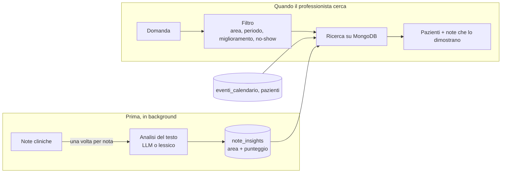

# FisioDesk – Query intelligenti sui dati clinici

Prototipo per il compito "AI Assistant: integrazione query intelligenti per professionisti sanitari". Un professionista scrive una domanda in italiano, per esempio la query target:

> *"Mostra pazienti con dolore lombare che hanno mostrato miglioramento negli ultimi 3 mesi ma hanno saltato l'ultimo appuntamento"*

e ottiene la lista dei pazienti, con gli estratti delle note cliniche che giustificano ogni risultato.

Stack: Java 17, Spring Boot 3.5, Spring AI 1.1, MongoDB. Ho scelto Java e Spring Boot perché è lo stack di FisioDesk/Dottai, così il codice si integra nel backend esistente. L'interfaccia demo è una pagina HTML/JS servita dalla stessa applicazione.

## Come far partire il sistema

Serve Docker con Compose v2.

```bash
git clone https://github.com/simplayy/fisiodesk-ai-healthcare-assignment.git
cd fisiodesk-ai-healthcare-assignment
docker compose up -d --build
```

Dopo circa un minuto (la prima volta di più, per scaricare le dipendenze):

- http://localhost:8080 interfaccia web e API
- http://localhost:8081 Mongo Express, per guardare i dati

All'avvio il database viene popolato con il dataset di esempio e le note vengono indicizzate. Di default non serve nessuna chiave: l'analisi dei testi usa un lessico fisioterapico. Per usare un LLM vedi "Modalità AI" più sotto.

## Demo della query target

Nell'interfaccia la query target è già scritta: basta premere **Cerca**. Da terminale:

```bash
curl -s -X POST http://localhost:8080/api/query \
  -H 'Content-Type: application/json' \
  -d '{"question":"Mostra pazienti con dolore lombare che hanno mostrato miglioramento negli ultimi 3 mesi ma hanno saltato l'\''ultimo appuntamento"}'
```

Risultato atteso: **Roberto Romano, Marco Colombo, Mario Rossi, Laura Bianchi** (in ordine di miglioramento). Esclusi: Anna Ferrari (lombalgia ma nessun miglioramento), Giuseppe Verdi (migliora, ma della cervicale, e non ha saltato l'ultimo appuntamento), Francesca Ricci (nessun dato recente).

Per ogni paziente la risposta mostra l'ultimo appuntamento e le note che hanno pesato. Il link "Come è nato il risultato" spiega quali parole della domanda sono state riconosciute, quanto ha impiegato ogni passaggio e chi è stato escluso e perché.

Altre domande che funzionano:

```
Pazienti con lombalgia che non mostrano miglioramento negli ultimi 3 mesi   -> Anna Ferrari
Pazienti con cervicalgia in miglioramento negli ultimi 2 mesi               -> Giuseppe Verdi
Chi ha saltato l'ultimo appuntamento?                                       -> tutti i no-show recenti
```

Il dataset copre marzo-dicembre 2024, quindi come "oggi" viene usata la data dell'ultimo evento in calendario (31/12/2024). Si può cambiare con la variabile `REFERENCE_DATE` o con il campo `referenceDate` della richiesta.

## Come funziona



L'idea è una sola: l'AI non lavora nel momento della ricerca, ma prima.

1. **Indicizzazione.** Un job (all'avvio e poi ogni 30 secondi) legge le note nuove o modificate di `schede_valutazione` e `diario_trattamenti` e per ognuna salva in `note_insights`: le aree anatomiche citate (con i sinonimi: "lombalgia", "mal di schiena", "low back pain", "colpo della strega" sono tutti `LUMBAR`), un punteggio di miglioramento da -3 a +3 (le negazioni contano: "non risponde alla terapia" è negativo) e le frasi che lo giustificano. Ogni nota viene analizzata una volta sola.
2. **Query.** La domanda viene tradotta in un filtro: area, finestra temporale, miglioramento sì/no, appuntamento saltato sì/no. Lo fa l'LLM, controllato da un parser a regole; senza LLM lavora solo il parser. Il filtro viene salvato, così la stessa domanda non passa più dall'AI. Poi viene eseguito con normali query MongoDB su `note_insights`, `eventi_calendario` e `pazienti`: per ogni paziente si sommano i punteggi delle note nel periodo e si guarda lo stato del suo ultimo appuntamento.

"Ultimo appuntamento saltato" significa: l'evento più recente del paziente fino alla data di riferimento ha stato `no_show`. Un ultimo evento `cancellato` o `prenotato` non conta.

Se l'LLM non risponde (timeout, errore, quota finita) il lessico prende il suo posto, sia per le note sia per le domande. Il sistema risponde comunque e nella risposta si vede quale componente ha lavorato.

## Trade-off principali

- **Analisi AI quando la nota viene indicizzata, non quando si cerca.** Il costo dipende dal numero di note e la query resta sotto i 100 ms. In cambio una nota appena scritta diventa cercabile al ciclo successivo (30 s), non subito.
- **Limite di tempo sull'LLM.** Una domanda nuova aspetta l'LLM al massimo 1,5 s; oltre risponde il parser a regole e il piano dell'LLM viene salvato per la volta dopo. Il tempo di risposta è sempre sotto controllo, ma la prima risposta a una domanda nuova può essere più grossolana.
- **Lessico + LLM invece di embedding.** Per questa query servono due segnali per nota (area e direzione del miglioramento): un classificatore li dà in modo spiegabile e il lessico corregge le negazioni che i modelli piccoli sbagliano. La ricerca vettoriale servirebbe per domande aperte, che qui non ci sono.

## Modalità AI (opzionale)

```bash
# LLM locale con Ollama (nessuna chiave, scarica circa 1 GB di modello)
docker compose -f docker-compose.yml -f docker-compose.ai.yml up -d --build

# Google Gemini (chiave in .env, vedi .env.example)
docker compose -f docker-compose.yml -f docker-compose.gemini.yml up -d --build

# qualunque endpoint compatibile OpenAI
AI_ENABLED=true AI_API_KEY=sk-... AI_MODEL=gpt-4o-mini docker compose up -d
```

Con l'LLM attivo le note vengono rianalizzate dal modello e le domande nuove interpretate dal modello; il lessico resta come controllo e come riserva. Con Gemini il vincolo dei 2 secondi regge con 100 utenti concorrenti (misure in [docs/DESIGN.md](docs/DESIGN.md)).

## Struttura del progetto

```
├── docker-compose.yml          # MongoDB + dati di esempio + applicazione + Mongo Express
├── docker-compose.ai.yml       # opzionale: LLM locale con Ollama
├── docker-compose.gemini.yml   # opzionale: Gemini
├── Dockerfile
├── data/                       # dataset di esempio (marzo-dicembre 2024)
├── docs/DESIGN.md              # scelte di progetto, configurazione, limiti, misure
├── scripts/                    # smoke-test.sh (query target), load-test.py (carico)
├── src/main/java/.../analysis  # lessico, analizzatori delle note, indexer
├── src/main/java/.../nlq       # domanda -> filtro: LLM, parser a regole, controllo
├── src/main/java/.../query     # esecuzione del filtro, cache, spiegazione
├── src/main/java/.../web       # API REST
├── src/main/resources/static   # interfaccia demo
└── src/test/java               # test unitari
```

I file `ai_integration_homework_v2.md` e `USE_CASES_AND_TESTS.md` sono la consegna e i casi d'uso forniti con il dataset.

## API

- `POST /api/query` con `{"question": "...", "referenceDate": "2024-12-31", "professionistaId": "..."}` (gli ultimi due opzionali; con `professionistaId` si vedono solo i pazienti di quel professionista). Risponde con il filtro interpretato, i pazienti con le loro note, e la spiegazione.
- `GET /api/stats` note indicizzate e analizzatore in uso.
- `GET /api/professionisti` professionisti presenti nei dati.
- `DELETE /api/cache` svuota cache e filtri salvati, per far ripassare una domanda dall'AI.

## Sviluppo e test

```bash
./gradlew test                       # test unitari
scripts/smoke-test.sh                # query target sul sistema in esecuzione
scripts/load-test.py load 60 5       # 60 utenti concorrenti
```

Per le scelte di progetto, la configurazione, i limiti noti e le misure di carico: [docs/DESIGN.md](docs/DESIGN.md).
