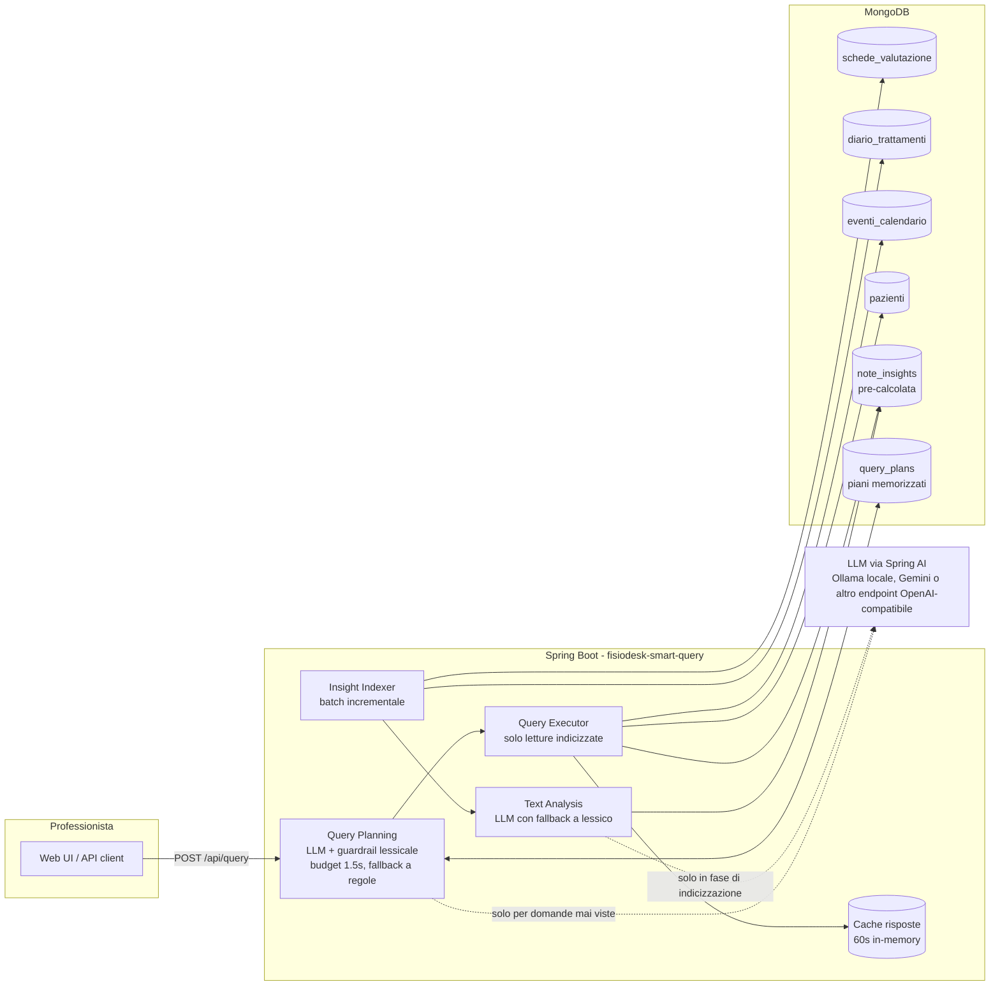

# FisioDesk – Query intelligenti sui dati clinici

Sistema di query in linguaggio naturale sui dati clinici di FisioDesk. Un professionista scrive una domanda come:

> *"Mostra pazienti con dolore lombare che hanno mostrato miglioramento negli ultimi 3 mesi ma hanno saltato l'ultimo appuntamento"*

e ottiene la lista dei pazienti corrispondenti, con gli estratti delle schede e del diario che giustificano ogni risultato. La ricerca sui testi non chiama l'AI: le note sono già analizzate e indicizzate, quindi la risposta arriva in poche decine di millisecondi. L'AI serve solo a interpretare una domanda nuova, una volta sola e con un limite di tempo.

**Stack**: Java 17, Spring Boot 3.5, Spring AI 1.1, Gradle, MongoDB. È lo stesso stack di FisioDesk/Dottai, quindi i componenti si integrano nel backend attuale senza aggiungere un runtime (Spring AI 1.1 è la versione compatibile con Boot 3; la 2.0 richiede Boot 4). Il frontend demo è HTML/JS statico servito dall'applicazione stessa.

---

## Avvio rapido

Prerequisiti: Docker con Compose v2 e BuildKit (qualsiasi Docker Desktop o Docker Engine recente).

```bash
git clone https://github.com/simplayy/fisiodesk-ai-healthcare-assignment.git
cd fisiodesk-ai-healthcare-assignment
docker compose up -d --build
```

Servizi disponibili:

| Servizio | URL |
|---|---|
| Web UI + API | http://localhost:8080 |
| API query | `POST http://localhost:8080/api/query` (opzionale `professionistaId` per lo scoping) |
| Stato indicizzazione | `GET http://localhost:8080/api/stats` |
| MongoDB | `localhost:27017` |
| Mongo Express | http://localhost:8081 |

Al primo avvio l'applicazione indicizza le note cliniche (qualche secondo in modalità deterministica); lo stato è visibile su `/api/stats` e nel piè di pagina della UI.

### Demo della query target

Dalla UI (http://localhost:8080) la query target è già precompilata: basta premere **Cerca**. Da terminale:

```bash
curl -s -X POST http://localhost:8080/api/query \
  -H 'Content-Type: application/json' \
  -d '{"question":"Mostra pazienti con dolore lombare che hanno mostrato miglioramento negli ultimi 3 mesi ma hanno saltato l'\''ultimo appuntamento"}'
```

Risultato atteso sul dataset demo: **Roberto Romano, Marco Colombo, Mario Rossi, Laura Bianchi** (in ordine di forza del miglioramento). Anna Ferrari è esclusa (lombalgia ma nessun miglioramento), Giuseppe Verdi è escluso (migliora ma sul rachide cervicale, e non ha saltato l'ultimo appuntamento), Francesca Ricci è esclusa (nessun dato recente).

Altre domande supportate, per mostrare che non è un sistema a query fissa:

```
Pazienti con lombalgia che non mostrano miglioramento negli ultimi 3 mesi   -> Anna Ferrari
Pazienti con cervicalgia in miglioramento negli ultimi 2 mesi               -> Giuseppe Verdi
Chi ha saltato l'ultimo appuntamento?                                       -> tutti i no-show recenti
```

Nota sui dati: `USE_CASES_AND_TESTS.md` parla di 18 schede e 16 note di diario, ma i file in `data/` ne contengono 17 e 15 (32 note in totale, tutte indicizzate); i sette casi descritti sono comunque tutti presenti.

Nota sulle date: il dataset copre marzo–dicembre 2024, quindi come "oggi" viene usata la data dell'ultimo evento in calendario (31/12/2024). È sovrascrivibile con la variabile `REFERENCE_DATE` o col campo `referenceDate` della richiesta.

### Modalità AI (opzionale)

Di default il sistema usa l'analizzatore deterministico (nessuna dipendenza esterna, risultati riproducibili). Con un LLM l'analisi delle note e l'interpretazione della domanda passano al modello; il lessico resta come verifica e come fallback.

```bash
# LLM locale via Ollama (nessuna chiave, ~1 GB di modello al primo avvio)
docker compose -f docker-compose.yml -f docker-compose.ai.yml up -d --build

# LLM hosted via Google Gemini (chiave in .env, vedi .env.example)
docker compose -f docker-compose.yml -f docker-compose.gemini.yml up -d --build

# Qualunque endpoint OpenAI-compatibile
AI_ENABLED=true AI_API_KEY=sk-... AI_MODEL=gpt-4o-mini docker compose up -d
```

L'output del modello è vincolato a uno schema JSON; le chiamate hanno timeout e retry; se l'LLM non risponde il sistema degrada sull'analizzatore deterministico e non si ferma mai. Dettagli su modelli, quote e latenza in [docs/DESIGN.md](docs/DESIGN.md).

Vincolo di latenza, misurato con `scripts/load-test.py` (Gemini, cache delle risposte fredda, tutti i piani dall'LLM, server a 4 core condiviso con MongoDB e col generatore di carico):

| Scenario | Richieste | p50 | p95 | max |
|---|---|---|---|---|
| 60 utenti concorrenti | 300 | 158 ms | 391 ms | 599 ms |
| 100 utenti concorrenti | 500 | 199 ms | 865 ms | 1296 ms |
| 10 domande mai viste nello stesso istante (planning LLM nella richiesta) | 10 | 1150 ms | 1350 ms | 1350 ms |

---

## Architettura



### Idea di fondo: analizzare ogni nota una volta sola

Con il vincolo dei 2 s per 50+ professionisti concorrenti e un budget AI limitato, l'AI non può stare nel percorso di risposta della query. La pipeline è divisa in due:

1. **Indicizzazione (batch, incrementale)**. Un job periodico confronta `schede_valutazione` e `diario_trattamenti` con la collection `note_insights`: ogni nota nuova o modificata (hash SHA-256 del testo) viene analizzata una sola volta e il risultato salvato: aree anatomiche citate (con i sinonimi: "lombalgia", "mal di schiena", "low back pain", "colpo della strega" → `LUMBAR`), segnale di miglioramento (da -3 a +3, tenendo conto delle negazioni: "non risponde bene alla terapia" non è un miglioramento) e frasi di evidenza. Il costo AI dipende da quante note vengono scritte, non da quante query vengono fatte.

2. **Query (real-time)**. La domanda viene tradotta in un piano strutturato (aree, finestra temporale, miglioramento richiesto, filtro no-show). Il piano lo produce l'LLM (output vincolato a JSON schema) e viene fuso con i marcatori espliciti del parser a regole: il modello capisce le parafrasi, il lessico evita che i termini espliciti vadano persi. Senza LLM lavora il solo parser a regole. Un piano non dipende dai dati, quindi viene calcolato una volta per domanda e salvato in `query_plans`. Poi il piano viene eseguito con normali query MongoDB indicizzate su `note_insights`, `eventi_calendario` e `pazienti`: nessuna analisi di testo a runtime. Una cache in memoria (60 s) assorbe le domande ripetute.

"Ultimo appuntamento saltato" è definito così: l'evento più recente del paziente con data ≤ data di riferimento ha stato `no_show`. Un ultimo evento `cancellato` o `prenotato` non conta come saltato.

### Cosa succede se l'AI non funziona

Ogni punto che usa l'LLM (interpretazione domanda, analisi note) ha un fallback deterministico basato su un lessico fisioterapico italiano con gestione delle negazioni. Le chiamate hanno timeout e un retry (Spring AI); esaurito quello, il fallback scatta per timeout, errori del provider o risposte non valide. Quando l'LLM torna disponibile, l'indexer ri-analizza (una volta sola) le note classificate col fallback.

---

## Trade-off principali

- **AI in fase di scrittura, non di lettura.** Ogni nota è analizzata una volta e il risultato è indicizzato; la query è solo letture Mongo. Costo proporzionale alle note, non alle ricerche; latenza sotto i 100 ms. In cambio una nota nuova è cercabile al ciclo successivo (30 s), non nell'istante.
- **Budget di latenza sul planner, con fallback a regole.** La domanda è tradotta in un piano dall'LLM entro un budget; oltre, risponde il parser a regole e il piano LLM viene memorizzato per la volta dopo. Tempo di risposta garantito; la prima richiesta di una domanda nuova può essere interpretata in modo più grezzo, e la risposta lo dichiara.
- **Lessico clinico + LLM invece di embeddings.** Per la query target servono segnali direzionali (migliora / non migliora) e di area anatomica: un classificatore per nota li cattura in modo spiegabile e il lessico corregge le negazioni che i modelli piccoli sbagliano. La vector search resta il passo successivo per le domande aperte.

## Struttura del progetto

```
├── docker-compose.yml          # MongoDB + seed dati + app + Mongo Express
├── docker-compose.ai.yml       # overlay opzionale: LLM locale via Ollama
├── docker-compose.gemini.yml   # overlay opzionale: LLM hosted via Gemini (chiave in .env)
├── Dockerfile                  # build multi-stage (Gradle -> JRE)
├── scripts/                    # smoke-test.sh (query target), load-test.py (latenza sotto carico)
├── data/                       # dataset demo (marzo-dicembre 2024)
├── src/main/java/com/fisiodesk/smartquery/
│   ├── analysis/               # lessico clinico, analizzatori, indexer batch
│   ├── nlq/                    # domanda -> piano: planner LLM/regole, guardrail, budget, plan store
│   ├── query/                  # esecuzione piano, cache, DTO
│   ├── web/                    # REST controller + error handling
│   └── domain/ repository/     # mapping collections MongoDB
├── src/main/resources/static/  # web UI demo
└── src/test/java/              # unit test (analizzatore, parser, esecuzione)
```

## Configurazione

| Variabile | Default | Significato |
|---|---|---|
| `MONGO_URI` | `mongodb://localhost:27017/fisiodesk` | connessione MongoDB (nel compose punta al container) |
| `REFERENCE_DATE` | *(vuoto → ultimo evento in calendario)* | "oggi" per le finestre relative, `yyyy-MM-dd` |
| `AI_ENABLED` | `false` | `true` per usare l'LLM (planner + analisi note) |
| `AI_BASE_URL` | `https://api.openai.com` | endpoint OpenAI-compatibile, senza `/v1` (es. `http://ollama:11434`) |
| `AI_COMPLETIONS_PATH` | `/v1/chat/completions` | path delle chat completions, per provider con prefisso diverso (Gemini: `/chat/completions` su `.../v1beta/openai`) |
| `AI_API_KEY` | `not-needed` | chiave del provider (ignorata da Ollama) |
| `AI_MODEL` | `gpt-4o-mini` | modello (es. `qwen2.5:1.5b` con Ollama, `gemini-3.5-flash-lite` con Gemini) |
| `AI_ANALYSIS_MODEL` | *(vuoto → `AI_MODEL`)* | modello separato per l'analisi delle note, per non condividere la quota con il planner |
| `AI_INDEXER_RPM` | `0` (nessun ritmo) | massimo di chiamate LLM al minuto dell'indexer, da tenere sotto la quota del provider |
| `GEMINI_API_KEY` | – | chiave Gemini, letta da `.env` dall'overlay `docker-compose.gemini.yml` |
| `AI_TIMEOUT_MS` | `20000` | timeout di lettura di una chiamata LLM |
| `AI_PLAN_TIMEOUT_MS` | `1500` (`1800` negli overlay AI) | budget di attesa del planner LLM in una richiesta utente: obiettivo di risposta meno il tempo di esecuzione |

## Troubleshooting

- **Domande nuove servite dal piano a regole (`planner: heuristic`)**: il planner LLM ha superato il budget (`AI_PLAN_TIMEOUT_MS`) o il provider ha risposto 429; il log riporta la durata di ogni chiamata (`LLM planned '...' in N ms`) e gli errori del provider. Sul piano gratuito Gemini il limite è 15 domande nuove/min per modello.
- **Mongo Express** (http://localhost:8081) è esposto senza password ma solo su `127.0.0.1`: è un comodo browser dei dati per la review, non va esposto altrove.
- **Ripartire da zero**: `docker compose down -v && docker compose up -d --build` (dati demo re-importati e ri-indicizzati automaticamente).
- **Stato dell'indicizzazione**: `curl localhost:8080/api/stats`; log applicativi: `docker logs fisiodesk-smart-query`.
- **Modalità AI locale lenta al primo avvio**: il download del modello è visibile con `docker logs fisiodesk-ollama-pull`; la prima analisi delle note su CPU richiede qualche minuto (`/api/stats` mostra `analyzedByLlm` crescere), nel frattempo le query rispondono con le analisi deterministiche.

## Sviluppo locale

```bash
# solo il database
docker compose up -d mongodb mongodb-seed

# applicazione in locale
./gradlew bootRun

# test
./gradlew test
```

## API

`POST /api/query`

```json
{ "question": "…", "referenceDate": "2024-12-31", "professionistaId": "507f1f77bcf86cd799439021" }
```

Risposta: piano interpretato (trasparenza su come è stata capita la domanda), risultati ordinati per forza del miglioramento con evidenze per nota, metadati (latenza, cache, data di riferimento) e un blocco `explain`. `referenceDate` e `professionistaId` sono opzionali.

**Spiegazione del risultato (`explain`).** Ogni risposta include come è stata prodotta, ricavato da quello che la pipeline ha fatto davvero e senza chiamate AI in più: origine del piano (AI in questa richiesta, piano memorizzato, parser a regole per timeout/AI assente), parole della domanda riconosciute dal lessico e come sono state lette (`"dolore lombare" → LUMBAR`), tempi per tappa (interpretazione, ricerca note, valutazione pazienti, totale) con i conteggi (note nella finestra, note sull'area, pazienti coinvolti), da dove viene la data di riferimento, e **ogni paziente con note nel periodo che è stato escluso, con il motivo** ("nessun miglioramento nell'area richiesta (punteggio -4 su 2 note)", "ultimo appuntamento completato il 20/12/2024, non saltato", "nessuna nota sull'area richiesta"). La UI lo apre in un popup dal link "Come è nato il risultato" accanto al conteggio, ed evidenzia nelle note i termini che hanno pesato. Link diretto a una domanda: `/?q=<domanda>&professionista=<id>&spiega=1`.

`DELETE /api/cache` svuota le risposte in cache (60 s) e i piani memorizzati: la domanda successiva ripassa dall'AI (link "Svuota cache" nella barra in alto della UI, accanto al selettore del professionista). Le analisi delle note non sono una cache e non vengono toccate. Endpoint di servizio per la demo, senza autenticazione come il resto dell'API.

**Scoping per professionista.** Con `professionistaId` la ricerca considera solo le note scritte da quel professionista: ognuno vede i propri pazienti (sul dataset: `…9021` → Rossi, Bianchi, Romano; `…9023` → Colombo; `…9022` → nessuno per la query target). Senza, la vista è amministrativa. In produzione l'id arriva dal token dell'utente autenticato, non dal body: qui è esplicito per la demo e la UI offre un selettore.

`GET /api/professionisti` restituisce i professionisti presenti nei dati (per il selettore della UI). `GET /api/stats` restituisce il numero di note indicizzate e l'analizzatore usato. `GET /actuator/health` è l'healthcheck.

## Riferimenti

- [Spring AI 1.1 – OpenAI chat e structured outputs](https://docs.spring.io/spring-ai/reference/1.1/api/chat/openai-chat.html) · [ChatClient](https://docs.spring.io/spring-ai/reference/1.1/api/chatclient.html)
- [Spring AI 2.0 / Spring Boot 4 – perché qui resta la linea 1.1](https://www.herodevs.com/blog-posts/spring-ai-2-0-is-coming-soon-your-boot-4-0-migration-does-not-have-to-start-tomorrow)
- [Ollama – structured outputs](https://docs.spring.io/spring-ai/reference/api/chat/ollama-chat.html)
- [Immagine Docker ufficiale di MongoDB](https://hub.docker.com/_/mongo)
