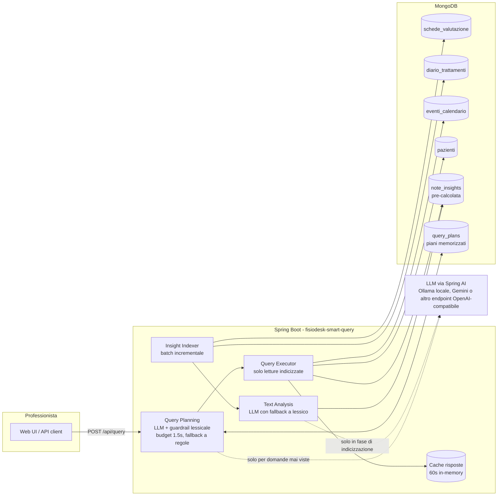

# Note di design

Le scelte tecniche per esteso. Il quadro generale è nel [README](../README.md), le risposte alla consegna in [RISPOSTE-CONSEGNA.md](RISPOSTE-CONSEGNA.md).

## Il problema, diviso in quattro

| Cosa chiede la query target | Che problema è | Quando lo risolvo |
|---|---|---|
| "dolore lombare", scritto in molti modi | capire un testo | in anticipo, quando indicizzo |
| "hanno mostrato miglioramento" | capire un testo, e in che direzione va | in anticipo, quando indicizzo |
| "negli ultimi 3 mesi" | filtro su una data | a ogni ricerca |
| "hanno saltato l'ultimo appuntamento" | filtro su un campo | a ogni ricerca |

I primi due sono lenti e ambigui: li risolvo una volta per nota e salvo il risultato. Gli altri due sono filtri banali. Tutto il resto del progetto viene da questa divisione.

## Architettura



In basso quello che succede in background, in alto quello che succede quando qualcuno cerca.

## La tabella `note_insights`

Un documento per ogni nota analizzata.

```javascript
{
  _id: "schede_valutazione:607f...9105",  // collection di origine + id della nota
  note_id, source_collection,
  paziente_id, professionista_id, data,   // copiati dalla nota, per filtrare qui
  text_hash: "sha256...",                 // impronta del testo
  body_areas: ["LUMBAR"],
  improvement_score: 2,                   // da -3 a +3
  excerpt, evidence: ["+netto miglioramento", ...],
  analyzer: "llm" | "heuristic",          // chi l'ha letta
  analyzed_at
}
```

L'id è costruito, non casuale: rianalizzare una nota sovrascrive il documento invece di duplicarlo. L'impronta serve a capire se la nota è cambiata: se è uguale, la nota viene saltata e non costa una chiamata.

Indici su `data`, `(paziente_id, data)` e `(professionista_id, data)`, più `(paziente_id, data)` su `eventi_calendario`, che rende immediata la ricerca dell'ultimo appuntamento di un paziente.

## Le regole con cui decide

- **Parte del corpo**: una nota conta solo se parla dell'area richiesta, e il miglioramento si somma solo su quelle note. Chi migliora della cervicale non passa una ricerca sulla lombalgia.
- **Miglioramento nel periodo**: somma dei punteggi delle note in finestra maggiore di zero.
- **Ultimo appuntamento saltato**: l'appuntamento più recente fino alla data di riferimento ha stato `no_show`. Se è `cancellato` non conta, il paziente ha avvisato. Se è `prenotato` con data già passata non conta: è un dato rimasto indietro, non una prova di assenza.

## Il dizionario di termini

Serve quando l'AI non c'è, e come controllo su quello che l'AI risponde. Cerca in tre passaggi, in quest'ordine:

1. **Frasi positive che contengono una negazione**: "nessun dolore", "senza limitazioni". Vanno cercate per prime, altrimenti il "nessun" porterebbe fuori strada.
2. **Negazioni di miglioramento**: "non migliora", "non risponde", "nessun miglioramento".
3. **Radici di parole** ("miglior", "recuper", "peggior", "stazionar"), che coprono tutte le forme. Con una guardia: se entro 12 caratteri prima c'è "non", "nessun" o "senza", il termine positivo non conta.

Il punteggio è la somma di quello che trova, limitato tra -3 e +3, e ogni termine finisce in `evidence`, così si vede su cosa si è basato. Da solo, senza AI, produce già il risultato corretto della query target sui dati di esempio.

## Ogni professionista vede solo i suoi pazienti

Ogni nota porta l'id di chi l'ha scritta. Se la richiesta indica un professionista, il sistema legge solo le sue note, con l'indice apposta: `…9021` vede Rossi, Bianchi e Romano, `…9023` vede Colombo, `…9022` nessuno per la query target. Senza indicazione la vista è completa.

Nel prodotto vero l'id arriverebbe da chi ha fatto il login. Qui è nella richiesta per poterlo mostrare nella demo.

Da notare: il filtro vale sulle note, non sul calendario. L'ultimo appuntamento è l'ultimo in assoluto del paziente, anche se preso con un altro professionista. Sui dati di esempio non si vede perché ogni paziente ne ha uno solo.

## La spiegazione allegata a ogni risposta

Il blocco `explain` è costruito da quello che il sistema ha fatto davvero, senza chiedere niente all'AI:

- da dove viene il filtro (AI in questa richiesta, filtro già salvato, o parser a regole perché l'AI mancava o era lenta) e quanto si è aspettato;
- quali parole della domanda sono state riconosciute e come sono state lette;
- durata e conteggi di ogni passaggio;
- da dove viene la data usata come "oggi";
- ogni paziente escluso con il motivo: "nessun miglioramento nell'area richiesta (punteggio -7 su 4 note)", "ultimo appuntamento prenotato il 28/12/2024, non saltato".

Meglio questo di un riassunto scritto dall'AI: costerebbe una chiamata a ogni ricerca e sarebbe meno affidabile dei dati. Si apre dal link "Come è nato il risultato", e si può linkare una domanda: `/?q=<domanda>&professionista=<id>&spiega=1`.

## Come è integrata l'AI

- **Libreria**: Spring AI 1.1. Parla il protocollo delle API OpenAI, ormai lo standard, quindi lo stesso codice va con OpenAI, Gemini, OpenRouter, Azure o un modello installato in azienda. L'ultimo caso in sanità conta: i testi clinici possono non poter uscire dall'infrastruttura.
- **Risposta a formato fisso**: al modello non si chiede testo libero ma di riempire dei campi prestabiliti, definiti da uno schema generato dal codice Java. Può sbagliare il contenuto, non la forma.
- **Dove interviene**: quando legge una nota in indicizzazione, e quando traduce una domanda mai vista in un filtro. Il filtro viene salvato, quindi succede una volta per domanda.
- **Costo**: proporzionale alle note scritte e alle domande diverse, non alle ricerche. Mille professionisti con venti note al giorno fanno circa ventimila chiamate brevi al giorno.
- **Quote del fornitore**: le richieste al minuto si contano per modello, quindi l'indicizzazione può usarne uno diverso (`AI_ANALYSIS_MODEL`) e ha un freno sulle chiamate al minuto (`AI_INDEXER_RPM`): una reindicizzazione non toglie spazio alle domande.
- **Tempo massimo di attesa**: 1,5 secondi, 1,8 con Gemini. Oltre, risponde il parser a regole mentre l'AI finisce per conto suo e il filtro viene salvato per la volta dopo. Quanto spesso succede e quanto pesa è misurato più sotto.
- **Richieste insieme**: dieci persone sulla stessa domanda nuova generano una sola chiamata, e fino a 16 chiamate possono partire insieme, così una raffica non si accoda. Le domande suggerite sono già interpretate all'avvio, insieme a qualche chiamata a vuoto per scaldare il collegamento: la prima dopo un riavvio costa 0,8 secondi in più solo per aprire la connessione.
- **HTTP/1.1 forzato**: con HTTP/2 il client Java mandava tutte le chiamate su una connessione sola e il fornitore le serviva in fila. Dieci domande insieme tornavano a scaglioni e l'ultima sforava.
- **Controllo sull'AI**: le aree trovate dal dizionario hanno la precedenza, i filtri espliciti che riconosce vengono aggiunti, e in contrasto "peggioramento" vince su "miglioramento". Su dieci domande di prova il modello piccolo in locale da solo ne prende sei, col controllo dieci. Con Gemini erano dieci già da solo.
- **Guasti**: tempo massimo, un secondo tentativo, poi il dizionario. Le note lette dal dizionario vengono rilette quando l'AI torna. Niente da riattivare a mano.
- **Modello locale**: `qwen2.5:1.5b`, gira senza scheda grafica con 8 GB di memoria insieme al database. Con una GPU basta cambiare `AI_MODEL`.

## Quanto è veloce, misurato

Con `scripts/load-test.py` sulla demo con Gemini attivo, su un server a 4 processori condiviso con il database e col generatore di carico.

| Situazione | Richieste | mediana | 95° perc. | la più lenta |
|---|---|---|---|---|
| 60 professionisti insieme, domande già viste | 300 | 56 ms | 141 ms | 156 ms |
| 100 professionisti insieme, domande già viste | 500 | 95 ms | 245 ms | 367 ms |
| 60 professionisti insieme, con domande mai viste | 300 | 121 ms | 1387 ms | 1627 ms |
| 10 domande mai viste nello stesso istante | 10 | 1068 ms | 1264 ms | 1264 ms |

Il caso peggiore è la terza riga, con l'AI dentro la richiesta: resta sotto i 2 secondi. Dopo un riavvio le note non vengono rilette (32 prima, 32 dopo, zero chiamate) e i filtri restano, perché stanno nel database.

## Quando scatta il fallback e quanto cambia la risposta

Se l'AI supera il tempo massimo risponde il parser a regole. Due domande: succede spesso, e quanto sbaglia.

**Quanto spesso.** Sulla demo con Gemini, su 30 domande interpretate: la più veloce 736 ms, mediana 1035 ms, la più lenta 1266 ms, contro un budget di 1800. Nessuna oltre il budget, quindi zero fallback. Con il modello locale su CPU è il contrario: sfora quasi sempre.

**Quanto cambia.** Ho preso le 28 domande già interpretate dall'AI e ho calcolato cosa avrebbe prodotto il parser a regole sulle stesse domande. Filtro identico in 24 casi su 28. Nei 4 diversi:

| Domanda | Cosa perde il parser a regole | Risultato |
|---|---|---|
| "Pazienti con gonalgia recuperati..." | non conosce "gonalgia" | non filtra per ginocchio, risposta più larga |
| "Chi ha la cervicalgia e sta peggio..." | cerca "peggior", non riconosce "sta peggio" | non filtra i peggiorati, risposta più larga |
| "...non si fa più vedere" | non conosce la perifrasi | non filtra gli appuntamenti saltati, risposta più larga |
| "...che non hanno fatto progressi" | cerca la negazione solo su "miglior", qui c'è "progressi" | legge il contrario: restituisce i migliorati |

Tre casi su quattro danno una risposta più larga del dovuto, che è l'errore meno grave. Uno dà la risposta opposta. In tutti i casi la risposta dichiara che l'ha interpretata il parser a regole, e dalla seconda volta la domanda usa il filtro dell'AI, che intanto è stato salvato.

## Le scelte discutibili

- **Modello piccolo in locale più dizionario, invece di un modello grande.** Gira ovunque e tiene i testi clinici in casa, ma sbaglia circa una domanda su tre sui termini espliciti; il dizionario recupera quei casi. Con un modello grande il dizionario non serve, ma non fa danno.
- **Unisco i dati nel codice invece che nel database.** MongoDB saprebbe unire le tabelle in una query sola (`$lookup`), ma tre ricerche separate e indicizzate sono più leggibili e più facili da testare. Costa qualche viaggio in più, irrilevante a questi volumi; con volumi veri si passerebbe alla query unica.
- **Gemini per la demo online.** Modelli separati per domande e note, freno sulle chiamate, tempo massimo 1,8 secondi. Con il piano gratuito si coprono 15 domande nuove al minuto: oltre serve il piano a pagamento, non codice diverso.

## Cosa non fa

- **I candidati vengono sempre dalle note.** "Chi ha saltato l'ultimo appuntamento?" guarda solo i pazienti con almeno una nota nel periodo: chi non è in cura da mesi non compare. Per una domanda di soli appuntamenti bisognerebbe partire dal calendario.
- **Le note cancellate restano.** Se una nota viene eliminata dal gestionale, la sua analisi resta. Servirebbe una pulizia periodica.
- **Domande che non capisce.** Se non riconosce né area, né andamento, né filtro sugli appuntamenti ("ciao"), restituisce tutti i pazienti del periodo invece di dire che non ha capito. E non gestisce la negazione sugli appuntamenti: "che non hanno saltato" viene letto come "che hanno saltato".
- **Modello locale e tempo massimo.** Senza scheda grafica una domanda nuova sfora quasi sempre: risponde il parser a regole e il filtro dell'AI serve dalla volta dopo. In locale l'AI dà il suo valore sulle note, non sull'interpretazione immediata.
- **Il dizionario prende alcune frasi fuori contesto.** Cerca "non risponde" e quindi conta come peggioramento anche "non risponde al telefono". Legge "collo del femore" come zona cervicale e "parte alta della schiena" come lombare. Sui dati di esempio non capita, ma su note vere sì, e siccome il dizionario ha la precedenza sull'AI quando i due discordano, può ribaltare una lettura corretta.
- **Il punteggio è una somma e ignora l'ordine.** "Peggiorato a novembre, ora nettamente migliorato" e la frase opposta ricevono lo stesso punteggio. Allo stesso modo una nota molto negativa di tre mesi fa annulla un miglioramento recente. Servirebbe pesare le note più recenti.
- **Nessun filtro sullo stato del paziente.** Un paziente `sospeso` o `archiviato` compare come gli altri: nei dati di esempio Francesca Ricci è sospesa. L'API restituisce lo stato, l'interfaccia non lo mostra.
- **I filtri delle domande non scadono.** Se l'AI interpreta male una domanda, quella lettura resta salvata e viene riusata finché non si svuota la cache con `DELETE /api/cache`.

## Cosa farei dopo

- **Aggiornamento immediato**: farsi avvisare da MongoDB quando una nota viene scritta, invece di controllare ogni 30 secondi.
- **Ricerca per somiglianza**: rappresentare ogni nota con dei vettori e cercare per somiglianza, per domande aperte tipo "pazienti con un quadro simile a questo". La struttura non cambierebbe.
- **Misurare la qualità**: far etichettare un gruppo di note dai fisioterapisti e confrontare periodicamente dizionario, AI e giudizio umano.

## Configurazione

| Variabile | Default | Significato |
|---|---|---|
| `MONGO_URI` | `mongodb://localhost:27017/fisiodesk` | connessione MongoDB (nel compose punta al container) |
| `REFERENCE_DATE` | *(vuoto → ultimo evento in calendario)* | "oggi" per le finestre relative, `yyyy-MM-dd` |
| `AI_ENABLED` | `false` | `true` per usare l'LLM (planner + analisi note) |
| `AI_BASE_URL` | `https://api.openai.com` | endpoint OpenAI-compatibile, senza `/v1` (es. `http://ollama:11434`) |
| `AI_COMPLETIONS_PATH` | `/v1/chat/completions` | path delle chat completions, per provider con prefisso diverso (Gemini: `/chat/completions` su `.../v1beta/openai`) |
| `AI_API_KEY` | `not-needed` | chiave del provider (ignorata da Ollama) |
| `AI_MODEL` | `gpt-4o-mini` | modello (es. `qwen2.5:1.5b` con Ollama, `gemini-3.5-flash-lite` con Gemini) |
| `AI_ANALYSIS_MODEL` | *(vuoto → `AI_MODEL`)* | modello separato per l'analisi delle note, per non condividere la quota con il planner |
| `AI_INDEXER_RPM` | `0` (nessun ritmo) | massimo di chiamate LLM al minuto dell'indexer, da tenere sotto la quota del provider |
| `GEMINI_API_KEY` | – | chiave Gemini, letta da `.env` dall'overlay `docker-compose.gemini.yml` |
| `AI_TIMEOUT_MS` | `20000` | timeout di lettura di una chiamata LLM |
| `AI_PLAN_TIMEOUT_MS` | `1500` (`1800` negli overlay AI) | budget di attesa del planner LLM in una richiesta utente: obiettivo di risposta meno il tempo di esecuzione |

## Se qualcosa non va

- **Le domande nuove vengono servite dal parser a regole invece che dall'AI**: l'AI ha superato il tempo massimo (`AI_PLAN_TIMEOUT_MS`) o il fornitore ha risposto che le richieste sono troppe. Nel log c'è la durata di ogni chiamata. Col piano gratuito di Gemini il limite è 15 domande nuove al minuto per modello.
- **Ripartire da zero**: `docker compose down -v && docker compose up -d --build`.
- **A che punto è l'indicizzazione**: `curl localhost:8080/api/stats`. Log: `docker logs fisiodesk-smart-query`.
- **Mongo Express** (porta 8081) è senza password ma risponde solo dal computer stesso.
- **Modalità AI locale lenta al primo avvio**: sta scaricando il modello, si segue con `docker logs fisiodesk-ollama-pull`. La prima lettura delle note senza scheda grafica richiede qualche minuto, e intanto le ricerche funzionano col dizionario.

## Riferimenti

- [Spring AI 1.1 - OpenAI chat e structured outputs](https://docs.spring.io/spring-ai/reference/1.1/api/chat/openai-chat.html), [ChatClient](https://docs.spring.io/spring-ai/reference/1.1/api/chatclient.html)
- [Spring AI 2.0 richiede Spring Boot 4](https://www.herodevs.com/blog-posts/spring-ai-2-0-is-coming-soon-your-boot-4-0-migration-does-not-have-to-start-tomorrow)
- [Ollama, structured outputs](https://docs.spring.io/spring-ai/reference/api/chat/ollama-chat.html)
- [Immagine Docker di MongoDB](https://hub.docker.com/_/mongo)
