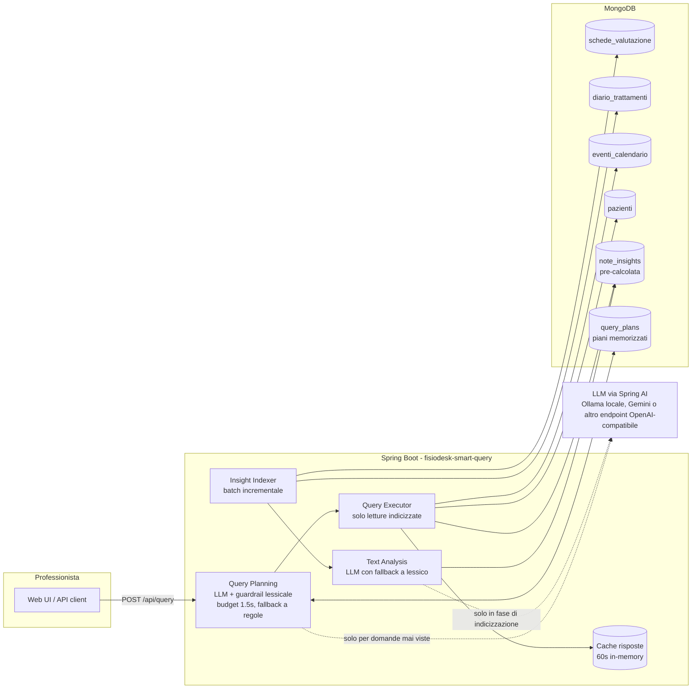

# Note di design

Approfondimento delle scelte dietro l'MVP; il quadro generale è nel [README](../README.md).

Le domande poste dalla consegna hanno una risposta puntuale in [RISPOSTE-CONSEGNA.md](RISPOSTE-CONSEGNA.md).

## Scomposizione del problema

La query target mescola quattro sotto-problemi con nature diverse:

| Sotto-problema | Natura | Dove si risolve |
|---|---|---|
| "dolore lombare" tra sinonimi e testo libero | comprensione del testo | indicizzazione (batch) |
| "hanno mostrato miglioramento" | comprensione del testo, direzionale | indicizzazione (batch) |
| "negli ultimi 3 mesi" | filtro temporale | query (real-time) |
| "hanno saltato l'ultimo appuntamento" | dato strutturato | query (real-time) |

I primi due sono costosi e ambigui: vanno risolti una volta per nota e memorizzati. Gli ultimi due sono filtri banali su dati strutturati: vanno risolti a ogni query. Il resto dell'architettura segue da questa separazione.

## Architettura



## La collection `note_insights`

Un documento per nota clinica analizzata:

```javascript
{
  _id: "schede_valutazione:607f...9105",  // upsert idempotente
  note_id, source_collection,
  paziente_id, professionista_id, data,   // denormalizzati per query dirette
  text_hash: "sha256...",                 // rilevamento modifiche
  body_areas: ["LUMBAR"],
  improvement_score: 2,                   // -3..+3
  excerpt, evidence: ["+netto miglioramento", ...],
  analyzer: "llm" | "heuristic",
  analyzed_at
}
```

Indici creati all'avvio: `data` (la query filtra per finestra temporale e poi per area in memoria), `(paziente_id, data)` e `(professionista_id, data)` per la vista scoped; su `eventi_calendario` un indice `(paziente_id, data)` rende la ricerca dell'ultimo appuntamento un seek e non una scansione.

## Semantica delle condizioni

- **Area anatomica**: una nota "conta" per la query se è taggata con l'area richiesta. Il miglioramento è calcolato **solo sulle note dell'area richiesta**: un paziente che migliora della cervicalgia non soddisfa una query sulla lombalgia, anche se "migliora" in generale.
- **Miglioramento nel periodo**: somma degli `improvement_score` delle note in finestra > 0, con almeno una nota positiva. Anna Ferrari (tutte note negative/stazionarie) resta fuori anche se ha tante note lombari.
- **Ultimo appuntamento saltato**: l'evento più recente con `data <= referenceDate` ha `stato == "no_show"`. Scelte esplicite: un ultimo evento `cancellato` non è un "salto" (il paziente ha avvisato); un ultimo evento `prenotato` con data passata è un dato sporco che non trattiamo come no-show.

## Analizzatore deterministico

Lessico fisioterapico italiano (sinonimi per area + marcatori di miglioramento/peggioramento) con tre livelli di matching, in ordine:

1. **Frasi positive esplicite** che contengono parole di negazione: "nessun dolore", "senza limitazioni".
2. **Negazioni esplicite di miglioramento**: "non migliora", "non risponde", "nessun miglioramento".
3. **Stem generici** ("miglior", "recuper", "peggior", "stazionar"…) con guardia di negazione: un termine positivo preceduto entro 12 caratteri da "non/nessun/senza" non conta.

Il punteggio è la somma dei match (clamp a ±3) e ogni match finisce nel campo `evidence`: il professionista vede *perché* un paziente è in lista. Sul dataset demo questo analizzatore da solo produce il risultato atteso esatto della query target.

## Multi-tenancy

Con `professionistaId` la ricerca considera solo le note scritte da quel professionista: ognuno vede i propri pazienti (sul dataset: `…9021` → Rossi, Bianchi, Romano; `…9023` → Colombo; `…9022` → nessuno per la query target). Senza, la vista è amministrativa. In produzione l'id arriverebbe dal token dell'utente autenticato; qui è nel body per la demo e la UI ha un selettore.

Ogni nota e ogni annotazione portano `professionista_id`; la query accetta uno scope opzionale e legge solo le annotazioni di quel professionista (indice `{professionista_id, data}`), quindi un professionista non vede mai i pazienti dei colleghi. Lo scope è un parametro esplicito solo per la demo: nel gestionale arriva dal token dell'utente autenticato e il servizio non lo accetta dal client. Senza scope la vista è amministrativa.

## Spiegabilità

Ogni risposta include come è stata prodotta, ricavato da quello che la pipeline ha fatto davvero e senza chiamate AI in più: origine del piano (AI in questa richiesta, piano memorizzato, parser a regole per timeout/AI assente), parole della domanda riconosciute dal lessico e come sono state lette (`"dolore lombare" → LUMBAR`), tempi per tappa (interpretazione, ricerca note, valutazione pazienti, totale) con i conteggi (note nella finestra, note sull'area, pazienti coinvolti), da dove viene la data di riferimento, e **ogni paziente con note nel periodo che è stato escluso, con il motivo** ("nessun miglioramento nell'area richiesta (punteggio -4 su 2 note)", "ultimo appuntamento completato il 20/12/2024, non saltato", "nessuna nota sull'area richiesta"). La UI lo apre in un popup dal link "Come è nato il risultato" accanto al conteggio, ed evidenzia nelle note i termini che hanno pesato. Link diretto a una domanda: `/?q=<domanda>&professionista=<id>&spiega=1`.

La risposta include il tracciato dell'esecuzione (`explain`): origine del piano e tempo di attesa, termini del lessico che hanno determinato ogni campo, tappe con durata e conteggi, pazienti esclusi con il motivo calcolato dallo stesso codice che li ha esclusi. Ho preferito un tracciato a un riassunto generato dal modello: costerebbe una chiamata a ogni query, sforerebbe la latenza e sarebbe meno affidabile dei dati.

## Integrazione LLM

- **Libreria**: Spring AI 1.1 (starter OpenAI). Il client parla il protocollo chat-completions, quindi lo stesso codice funziona con OpenAI, Gemini (endpoint `/v1beta/openai`), OpenRouter, Azure o un Ollama on-premise (rilevante in sanità: i testi clinici possono non uscire dall'infrastruttura). Retry, timeout e serializzazione li fa la libreria.
- **Structured output**: l'output del modello è vincolato a uno schema JSON generato dai record Java (`BeanOutputConverter` + `response_format: json_schema`). Il modello può sbagliare il significato ma non la forma: niente parsing difensivo, niente valori fuori enum.
- **Dove**: (1) analisi nota in fase di indicizzazione; (2) traduzione domanda→piano, una sola volta per domanda distinta (il piano non dipende dai dati ed è memorizzato in `query_plans`).
- **Budget**: il costo è O(note scritte + domande distinte), non O(query). 1.000 professionisti × 20 note/giorno ≈ 20k chiamate corte/giorno, batchabili e con modello economico.
- **Quote del provider**: l'indexer è ritmato (`max-llm-calls-per-minute`) e può usare un modello diverso dal planner (`analysis-model`): i limiti di richieste/minuto sono per modello, quindi una ri-indicizzazione massiva non può mai rallentare le domande interattive né farle ripiegare sul parser a regole.
- **Latenza**: il planner ha un budget (`plan-timeout-ms`: 1,5 s di default, 1,8 s con Gemini, cioè l'obiettivo di 2 s meno l'esecuzione che costa decine di ms). Oltre, la richiesta è servita col piano a regole mentre l'LLM completa in background e il piano viene salvato; richieste concorrenti per la stessa domanda condividono una sola chiamata; le domande suggerite sono pre-pianificate all'avvio e il client LLM viene "scaldato" con chiamate reali (dopo un riavvio la prima chiamata paga apertura HTTPS e JIT, ~0,8 s in più); il pool delle chiamate di planning è largo (16) perché una raffica di domande nuove non deve accodarsi. Il client HTTP verso il provider è forzato a HTTP/1.1 con pool di connessioni: con HTTP/2 il client JDK multiplexava tutte le chiamate su una connessione e il provider le serviva in serie (dieci domande simultanee tornavano a scalini di ~60 ms, l'ultima fuori budget); con una connessione per chiamata dieci domande nuove simultanee sono pianificate dall'LLM in 0,85–1,2 s ciascuna.
- **Guardrail lessicale**: il piano LLM viene fuso con quello a regole: le aree anatomiche del lessico prevalgono (vocabolario chiuso, il lessico è preciso), i flag espliciti trovati dal lessico vengono aggiunti, "peggioramento" vince su "miglioramento" in caso di contrasto. Su un set di 10 domande di controllo il modello locale da 1.5B da solo ne interpreta correttamente 6 (sbaglia "guariti", "sta meglio", una negazione, un'area); con il guardrail sono tutte corrette. Con un modello più capace il guardrail è neutro (con Gemini Flash-Lite le 10 domande sono corrette già senza).
- **Guasti**: timeout, un retry, fallback deterministico per singola chiamata; quando l'LLM torna disponibile le note analizzate col fallback vengono rianalizzate una volta. Non c'è niente da riarmare a mano.
- **Scelta del modello locale**: `qwen2.5:1.5b` perché gira su CPU con 8 GB di RAM insieme a MongoDB e se la cava bene in italiano. Con una GPU si può passare a Qwen3 8B cambiando `AI_MODEL`.

## Misure di carico

Vincolo di latenza, misurato con `scripts/load-test.py` (Gemini, cache delle risposte fredda, tutti i piani dall'LLM, server a 4 core condiviso con MongoDB e col generatore di carico):

| Scenario | Richieste | p50 | p95 | max |
|---|---|---|---|---|
| 60 utenti concorrenti | 300 | 158 ms | 391 ms | 599 ms |
| 100 utenti concorrenti | 500 | 199 ms | 865 ms | 1296 ms |
| 10 domande mai viste nello stesso istante (planning LLM nella richiesta) | 10 | 1150 ms | 1350 ms | 1350 ms |

## Altri trade-off

- **LLM piccolo e locale + guardrail lessicale, invece di un modello grande.** Un modello da 1.5B su CPU gira ovunque e tiene i testi clinici in casa, ma sbaglia ~1 domanda su 3 sui marcatori espliciti ("guariti", negazioni); la fusione col parser a regole recupera esattamente quei casi. Con un modello hosted il guardrail è neutro.
- **Correlazione nel service invece di una `$lookup` a tre stadi.** Query indicizzate separate su insights, calendario e anagrafica: più leggibile e testabile, con qualche round-trip in più (irrilevante a questi volumi; con volumi reali si passerebbe a una `$lookup` singola o a una vista per professionista).
- **Provider Gemini nell'overlay**: modello per il planner e modello separato per l'analisi delle note perché le quote del provider sono per modello; indexer ritmato sotto la quota (`AI_INDEXER_RPM`); budget del planner 1,8 s. Sul piano gratuito (15 richieste/min per modello) il planner copre 15 domande nuove al minuto; per andare oltre basta il piano a pagamento.

## Limiti noti

- **I candidati vengono dalle note.** Una domanda puramente di calendario ("chi ha saltato l'ultimo appuntamento?") considera solo i pazienti che hanno almeno una nota nella finestra: chi non è più in cura da mesi non compare. Per un sistema di ricerca clinica va bene, ma per una domanda di sola compliance bisognerebbe partire da `eventi_calendario`.
- **Cancellazioni non riconciliate.** Se una nota viene eliminata dal gestionale, il suo documento in `note_insights` resta. L'indexer confronta solo ciò che esiste; una passata di pulizia è un `deleteMany` sugli id non più presenti.
- **Domande senza filtri riconosciuti.** Una domanda in cui né il lessico né il modello trovano un'area, un andamento o il filtro no-show ("ciao") restituisce tutti i pazienti con note nel periodo invece di un errore. Allo stesso modo la negazione sul no-show ("che *non* hanno saltato l'ultimo appuntamento") non è gestita e viene letta come "saltato".
- **Modello locale e budget del planner.** Con Ollama su CPU una domanda nuova supera quasi sempre il budget: la risposta arriva dal parser a regole e il piano dell'LLM viene usato dalla volta successiva. È il comportamento previsto: la modalità locale mostra il valore dell'LLM sulle note, non sull'interpretazione in tempo reale.

## Possibili sviluppi (non implementati)

- **Freshness**: sostituire il polling a 30s con MongoDB change streams sulle collections sorgente.
- **Vector search**: aggiungere un embedding per nota in `note_insights` e usare l'indice vettoriale di Atlas per query aperte ("pazienti con quadro simile a…"); la struttura non cambia.
- **Valutazione qualità**: golden set di note etichettate dai clinici, confronto periodico analizzatore vs LLM vs umano prima di allargare i casi d'uso.

## Configurazione

| Variabile | Default | Significato |
|---|---|---|
| `MONGO_URI` | `mongodb://localhost:27017/fisiodesk` | connessione MongoDB (nel compose punta al container) |
| `REFERENCE_DATE` | *(vuoto → ultimo evento in calendario)* | "oggi" per le finestre relative, `yyyy-MM-dd` |
| `AI_ENABLED` | `false` | `true` per usare l'LLM (planner + analisi note) |
| `AI_BASE_URL` | `https://api.openai.com` | endpoint OpenAI-compatibile, senza `/v1` (es. `http://ollama:11434`) |
| `AI_COMPLETIONS_PATH` | `/v1/chat/completions` | path delle chat completions, per provider con prefisso diverso (Gemini: `/chat/completions` su `.../v1beta/openai`) |
| `AI_API_KEY` | `not-needed` | chiave del provider (ignorata da Ollama) |
| `AI_MODEL` | `gpt-4o-mini` | modello (es. `qwen2.5:1.5b` con Ollama, `gemini-3.5-flash-lite` con Gemini) |
| `AI_ANALYSIS_MODEL` | *(vuoto → `AI_MODEL`)* | modello separato per l'analisi delle note, per non condividere la quota con il planner |
| `AI_INDEXER_RPM` | `0` (nessun ritmo) | massimo di chiamate LLM al minuto dell'indexer, da tenere sotto la quota del provider |
| `GEMINI_API_KEY` | – | chiave Gemini, letta da `.env` dall'overlay `docker-compose.gemini.yml` |
| `AI_TIMEOUT_MS` | `20000` | timeout di lettura di una chiamata LLM |
| `AI_PLAN_TIMEOUT_MS` | `1500` (`1800` negli overlay AI) | budget di attesa del planner LLM in una richiesta utente: obiettivo di risposta meno il tempo di esecuzione |

## Troubleshooting

- **Domande nuove servite dal piano a regole (`planner: heuristic`)**: il planner LLM ha superato il budget (`AI_PLAN_TIMEOUT_MS`) o il provider ha risposto 429; il log riporta la durata di ogni chiamata (`LLM planned '...' in N ms`) e gli errori del provider. Sul piano gratuito Gemini il limite è 15 domande nuove/min per modello.
- **Mongo Express** (http://localhost:8081) è senza password ma ascolta solo su `127.0.0.1`: serve per guardare i dati durante la review, non per altro.
- **Ripartire da zero**: `docker compose down -v && docker compose up -d --build` (dati demo re-importati e ri-indicizzati automaticamente).
- **Stato dell'indicizzazione**: `curl localhost:8080/api/stats`; log applicativi: `docker logs fisiodesk-smart-query`.
- **Modalità AI locale lenta al primo avvio**: il download del modello è visibile con `docker logs fisiodesk-ollama-pull`; la prima analisi delle note su CPU richiede qualche minuto (`/api/stats` mostra `analyzedByLlm` crescere), nel frattempo le query rispondono con le analisi deterministiche.

## Riferimenti

- [Spring AI 1.1 - OpenAI chat e structured outputs](https://docs.spring.io/spring-ai/reference/1.1/api/chat/openai-chat.html), [ChatClient](https://docs.spring.io/spring-ai/reference/1.1/api/chatclient.html)
- [Spring AI 2.0 richiede Spring Boot 4](https://www.herodevs.com/blog-posts/spring-ai-2-0-is-coming-soon-your-boot-4-0-migration-does-not-have-to-start-tomorrow)
- [Ollama, structured outputs](https://docs.spring.io/spring-ai/reference/api/chat/ollama-chat.html)
- [Immagine Docker di MongoDB](https://hub.docker.com/_/mongo)
