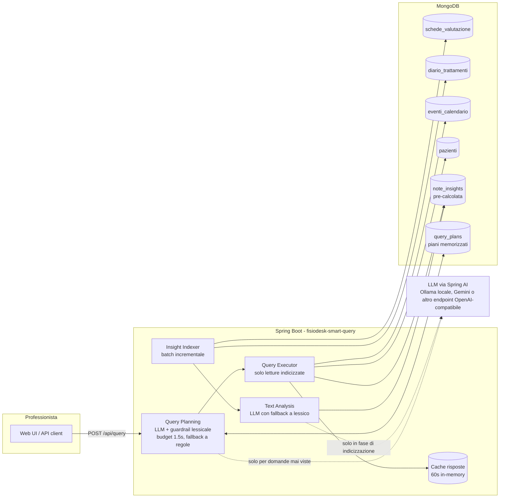

# Note di design

Dettaglio delle scelte. Il quadro generale è nel [README](../README.md), le risposte alle domande della consegna in [RISPOSTE-CONSEGNA.md](RISPOSTE-CONSEGNA.md).

## Scomposizione del problema

| Sotto-problema | Natura | Dove si risolve |
|---|---|---|
| "dolore lombare" tra sinonimi e testo libero | comprensione del testo | indicizzazione (batch) |
| "hanno mostrato miglioramento" | comprensione del testo, direzionale | indicizzazione (batch) |
| "negli ultimi 3 mesi" | filtro temporale | query (real-time) |
| "hanno saltato l'ultimo appuntamento" | dato strutturato | query (real-time) |

I primi due sono costosi e ambigui: si risolvono una volta per nota e si memorizzano. Gli altri due sono filtri banali: si risolvono a ogni query.

## Architettura



## La collection `note_insights`

```javascript
{
  _id: "schede_valutazione:607f...9105",  // upsert idempotente
  note_id, source_collection,
  paziente_id, professionista_id, data,   // denormalizzati per query dirette
  text_hash: "sha256...",                 // rilevamento modifiche
  body_areas: ["LUMBAR"],
  improvement_score: 2,                   // -3..+3
  excerpt, evidence: ["+netto miglioramento", ...],
  analyzer: "llm" | "heuristic",
  analyzed_at
}
```

Indici: su `note_insights` `data`, `(paziente_id, data)`, `(professionista_id, data)`; su `eventi_calendario` `(paziente_id, data)`, che rende la ricerca dell'ultimo appuntamento un seek.

## Semantica delle condizioni

- **Area**: una nota conta solo se taggata con l'area richiesta, e il miglioramento si somma solo su quelle note. Chi migliora della cervicalgia non passa una query sulla lombalgia.
- **Miglioramento nel periodo**: somma degli `improvement_score` in finestra maggiore di zero.
- **Ultimo appuntamento saltato**: l'evento più recente con `data <= referenceDate` ha `stato == "no_show"`. Un ultimo evento `cancellato` non conta (il paziente ha avvisato), un `prenotato` con data passata nemmeno (dato sporco).

## Analizzatore a dizionario

Termini fisioterapici italiani, con tre livelli di matching in quest'ordine:

1. **Frasi positive che contengono negazioni**: "nessun dolore", "senza limitazioni".
2. **Negazioni di miglioramento**: "non migliora", "non risponde", "nessun miglioramento".
3. **Radici generiche** ("miglior", "recuper", "peggior", "stazionar") con guardia: un termine positivo preceduto entro 12 caratteri da "non/nessun/senza" non conta.

Punteggio = somma dei match, limitato a più o meno 3. Ogni match finisce in `evidence`, quindi il professionista vede perché un paziente è in lista. Da solo, sul dataset demo, produce già il risultato esatto della query target.

## Multi-tenancy

Ogni nota porta `professionista_id`. Con `professionistaId` nella richiesta si leggono solo le note di quel professionista, tramite l'indice `(professionista_id, data)`: sul dataset `…9021` vede Rossi, Bianchi e Romano, `…9023` vede Colombo, `…9022` nessuno per la query target. Senza, la vista è amministrativa.

In produzione l'id arriverebbe dal token dell'utente e il servizio non lo accetterebbe dal client; qui è nel body per poter mostrare lo scoping nella demo.

## Spiegabilità

Ogni risposta porta un blocco `explain` costruito da quello che l'esecuzione ha fatto, senza chiamate AI aggiuntive:

- origine del filtro (AI in questa richiesta, filtro già salvato, parser a regole per timeout o AI assente) e tempo di attesa;
- parole della domanda riconosciute e come sono state lette (`"dolore lombare" -> LUMBAR`);
- tempi e conteggi di ogni tappa (note nella finestra, note sull'area, pazienti valutati);
- da dove viene la data di riferimento;
- ogni paziente escluso con il motivo ("nessun miglioramento nell'area richiesta (punteggio -7 su 4 note)", "ultimo appuntamento prenotato il 28/12/2024, non saltato").

Non è un riassunto generato dal modello: costerebbe una chiamata a ogni query e sarebbe meno affidabile dei dati. La UI lo mostra in un popup e evidenzia nelle note i termini che hanno pesato. Link diretto: `/?q=<domanda>&professionista=<id>&spiega=1`.

## Integrazione LLM

- **Libreria**: Spring AI 1.1, starter OpenAI. Parla il protocollo chat-completions, quindi lo stesso codice va con OpenAI, Gemini, OpenRouter, Azure o Ollama on-premise (in sanità conta: i testi possono non uscire dall'infrastruttura). Retry, timeout e serializzazione li fa la libreria.
- **Structured output**: risposta vincolata a uno schema JSON generato dai record Java (`BeanOutputConverter` più `response_format: json_schema`). Il modello può sbagliare il significato, non la forma.
- **Dove**: analisi della nota in indicizzazione; traduzione domanda in filtro, una volta per domanda distinta (salvata in `query_plans`).
- **Costo**: O(note scritte + domande distinte), non O(query). 1.000 professionisti con 20 note al giorno fanno circa 20k chiamate corte al giorno.
- **Quote**: l'indexer è ritmato (`AI_INDEXER_RPM`) e può usare un modello diverso dal planner (`AI_ANALYSIS_MODEL`), perché i limiti sono per modello: una reindicizzazione non rallenta le domande.
- **Budget di latenza**: `plan-timeout-ms`, 1,5 s di default e 1,8 s con Gemini. Oltre, risponde il parser a regole mentre l'LLM finisce in background e il filtro viene salvato.
- **Concorrenza**: richieste sulla stessa domanda condividono una sola chiamata; pool di 16 thread perché una raffica di domande nuove non si accodi; domande suggerite pre-interpretate all'avvio; client "scaldato" con chiamate reali (dopo un riavvio la prima paga apertura HTTPS e JIT, circa 0,8 s in più).
- **HTTP/1.1 forzato**: con HTTP/2 il client JDK multiplexava tutto su una connessione e il provider serviva le chiamate in serie (dieci domande insieme tornavano a scalini di 60 ms, l'ultima fuori budget).
- **Guardrail**: le aree del dizionario prevalgono, i flag espliciti trovati dal dizionario vengono aggiunti, "peggioramento" vince su "miglioramento". Su 10 domande di controllo il modello locale da 1,5B da solo ne prende 6, col guardrail 10. Con Gemini Flash-Lite erano già 10 senza.
- **Guasti**: timeout, un retry, fallback per singola chiamata; quando l'LLM torna, le note analizzate col fallback vengono rilette una volta. Niente da riarmare a mano.
- **Modello locale**: `qwen2.5:1.5b`, gira su CPU con 8 GB di RAM insieme a MongoDB. Con una GPU basta cambiare `AI_MODEL` (per esempio Qwen3 8B).

## Misure di carico

`scripts/load-test.py` sulla demo con Gemini attivo, server a 4 core condiviso con MongoDB e col generatore di carico.

| Scenario | Richieste | mediana | 95° perc. | massimo |
|---|---|---|---|---|
| 60 professionisti insieme, domande già note | 300 | 56 ms | 141 ms | 156 ms |
| 100 professionisti insieme, domande già note | 500 | 95 ms | 245 ms | 367 ms |
| 60 professionisti insieme, con domande mai viste | 300 | 121 ms | 1387 ms | 1627 ms |
| 10 domande mai viste nello stesso istante | 10 | 1068 ms | 1264 ms | 1264 ms |

Il caso peggiore è la terza riga, con la chiamata AI dentro la richiesta: resta sotto i 2 s. Dopo un riavvio le note non vengono rianalizzate (verificato: 32 prima e dopo, zero chiamate) e i filtri restano, perché stanno in MongoDB.

## Altri trade-off

- **Modello piccolo locale più guardrail, invece di un modello grande.** Un 1,5B su CPU gira ovunque e tiene i testi in casa, ma sbaglia circa una domanda su tre sui marcatori espliciti; il dizionario recupera quei casi.
- **Correlazione nel service invece di una `$lookup` a tre stadi.** Query separate e indicizzate: più leggibile e testabile, qualche round-trip in più. Con volumi reali si passerebbe a una `$lookup` o a una vista per professionista.
- **Gemini nell'overlay**: modelli separati per domande e note, indexer ritmato, budget 1,8 s. Sul piano gratuito il planner copre 15 domande nuove al minuto.

## Limiti noti

- **I candidati vengono dalle note.** "Chi ha saltato l'ultimo appuntamento?" considera solo chi ha almeno una nota nella finestra: chi non è in cura da mesi non compare. Per una domanda di sola compliance servirebbe partire da `eventi_calendario`.
- **Cancellazioni non riconciliate.** Se una nota viene eliminata, il suo documento in `note_insights` resta.
- **Domande senza filtri riconosciuti.** "ciao" restituisce tutti i pazienti con note nel periodo invece di un errore. La negazione sul no-show ("che non hanno saltato") non è gestita.
- **Modello locale e budget.** Con Ollama su CPU una domanda nuova supera quasi sempre il budget: risponde il parser a regole e il filtro dell'LLM serve dalla volta dopo.

## Possibili sviluppi (non implementati)

- **Freshness**: change stream di MongoDB al posto del polling a 30 s.
- **Vector search**: un embedding per nota e indice vettoriale di Atlas per domande aperte ("pazienti con quadro simile a…"). La struttura non cambia.
- **Qualità**: golden set di note etichettate dai clinici, confronto periodico dizionario contro LLM contro umano.

## Configurazione

| Variabile | Default | Significato |
|---|---|---|
| `MONGO_URI` | `mongodb://localhost:27017/fisiodesk` | connessione MongoDB (nel compose punta al container) |
| `REFERENCE_DATE` | *(vuoto → ultimo evento in calendario)* | "oggi" per le finestre relative, `yyyy-MM-dd` |
| `AI_ENABLED` | `false` | `true` per usare l'LLM (planner + analisi note) |
| `AI_BASE_URL` | `https://api.openai.com` | endpoint OpenAI-compatibile, senza `/v1` (es. `http://ollama:11434`) |
| `AI_COMPLETIONS_PATH` | `/v1/chat/completions` | path delle chat completions, per provider con prefisso diverso (Gemini: `/chat/completions` su `.../v1beta/openai`) |
| `AI_API_KEY` | `not-needed` | chiave del provider (ignorata da Ollama) |
| `AI_MODEL` | `gpt-4o-mini` | modello (es. `qwen2.5:1.5b` con Ollama, `gemini-3.5-flash-lite` con Gemini) |
| `AI_ANALYSIS_MODEL` | *(vuoto → `AI_MODEL`)* | modello separato per l'analisi delle note, per non condividere la quota con il planner |
| `AI_INDEXER_RPM` | `0` (nessun ritmo) | massimo di chiamate LLM al minuto dell'indexer, da tenere sotto la quota del provider |
| `GEMINI_API_KEY` | – | chiave Gemini, letta da `.env` dall'overlay `docker-compose.gemini.yml` |
| `AI_TIMEOUT_MS` | `20000` | timeout di lettura di una chiamata LLM |
| `AI_PLAN_TIMEOUT_MS` | `1500` (`1800` negli overlay AI) | budget di attesa del planner LLM in una richiesta utente: obiettivo di risposta meno il tempo di esecuzione |

## Troubleshooting

- **Domande nuove servite dal parser a regole**: l'AI ha superato `AI_PLAN_TIMEOUT_MS` o il provider ha risposto 429. Nel log c'è la durata di ogni chiamata (`LLM planned '...' in N ms`). Sul piano gratuito Gemini il limite è 15 domande nuove al minuto per modello.
- **Ripartire da zero**: `docker compose down -v && docker compose up -d --build`.
- **Stato dell'indicizzazione**: `curl localhost:8080/api/stats`. Log: `docker logs fisiodesk-smart-query`.
- **Mongo Express** (porta 8081) è senza password ma ascolta solo su `127.0.0.1`.
- **AI locale lenta al primo avvio**: il download del modello si segue con `docker logs fisiodesk-ollama-pull`; la prima lettura delle note su CPU richiede qualche minuto, nel frattempo le query rispondono col dizionario.

## Riferimenti

- [Spring AI 1.1 - OpenAI chat e structured outputs](https://docs.spring.io/spring-ai/reference/1.1/api/chat/openai-chat.html), [ChatClient](https://docs.spring.io/spring-ai/reference/1.1/api/chatclient.html)
- [Spring AI 2.0 richiede Spring Boot 4](https://www.herodevs.com/blog-posts/spring-ai-2-0-is-coming-soon-your-boot-4-0-migration-does-not-have-to-start-tomorrow)
- [Ollama, structured outputs](https://docs.spring.io/spring-ai/reference/api/chat/ollama-chat.html)
- [Immagine Docker di MongoDB](https://hub.docker.com/_/mongo)
